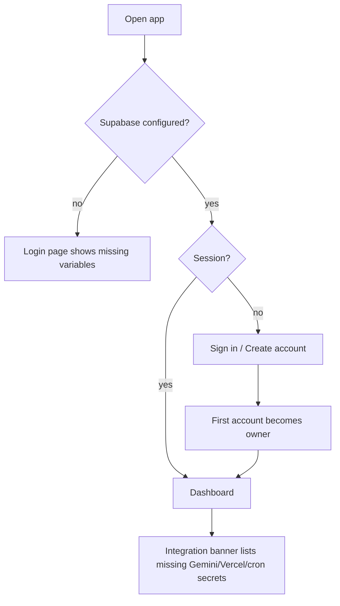
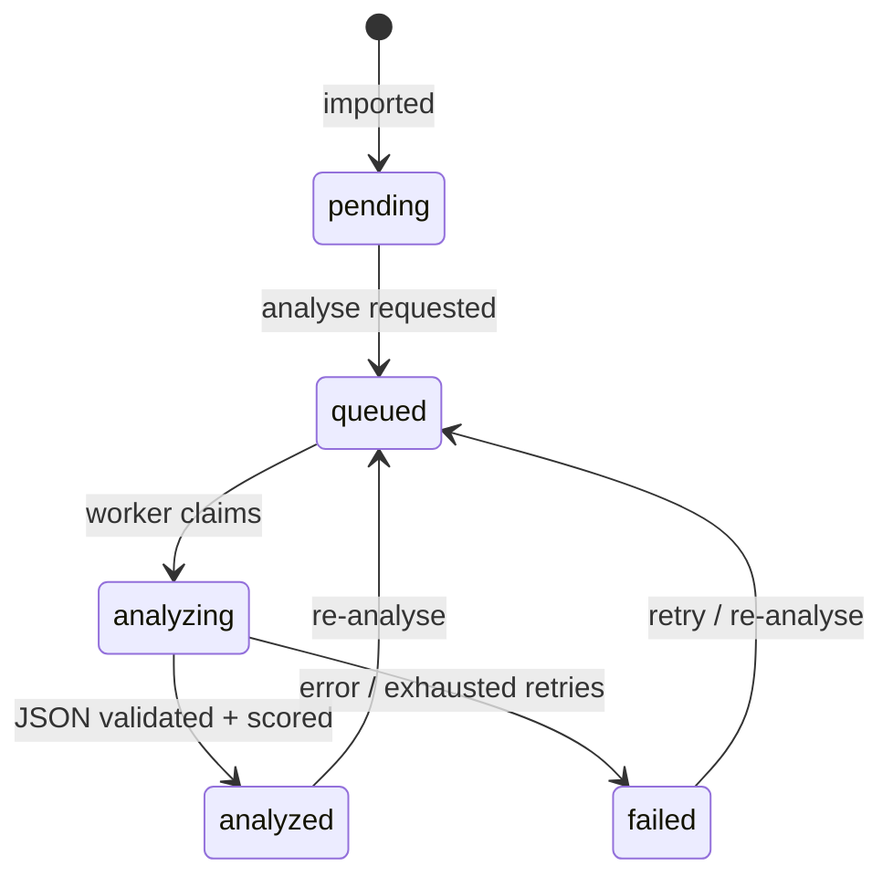
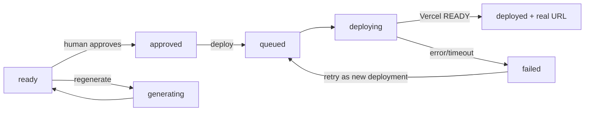

# Application Flow

## 1. First run

1. Configure `.env.local` (see `docs/ENVIRONMENT-VARIABLES.md`).
2. Apply migrations (`pnpm db:push`).
3. Sign up. The profile trigger creates the row and assigns `owner` to the first account.
4. Review **Settings → Integrations**; each card lists exactly which variables are missing.

## 2. Connect a source and rules

1. **Sources → Add** a manual or extension source (optional group URL).
2. **Collection rules → Save rule** with include/exclude keywords and categories.
3. Rules are hints: imports are never silently discarded. The extension shows the matched rule;
   the import API returns `matchedRule`.

## 3. Import a lead

### Manual

1. **Import lead** → paste the post text, optional URL/source.
2. Choose "Queue Gemini analysis immediately" (default on).
3. Submission returns either a new lead or the existing duplicate; both navigate to the detail page.

### Chrome extension

1. Open a Facebook post you can already view.
2. Click the extension → **Capture post from this tab** (one-off injection, active tab only).
3. Review/edit the text and URL; **Import lead**.
4. Duplicate results link to the existing lead.

## 4. Analyse

- The detail page polls while a job is queued/running.
- On success the page shows category, required features with quotes, budget/urgency/intent
  signals, evidence quotes, suggested next action, demo scope, and the score breakdown.
- The score is a fixed-weight computation (never a model number). Unknown signals score zero.

## 5. Generate a demo

1. **Demo studio** lists analysed leads by score.
2. Expand **Generate concept demo**: title + template (local-service, portfolio, saas-landing).
3. Worker: Gemini spec → deterministic render → manifest validation → artifact stored.
4. Demo detail shows the sandboxed preview and the manifest (files, sizes, checksum).
5. Regeneration is allowed; it clears approval and requires re-approval.

## 6. Approve and deploy

- Approval is a separate POST; deployment is disabled without it.
- Missing Vercel configuration returns a visible error, not a fake URL.
- Deployment history records every attempt, including errors; retries poll an existing Vercel
  deployment rather than creating duplicates.

## 7. Outreach

1. On a lead, the composer pre-fills a short draft; edit it, optionally attach a demo, save.
2. Copy the text and send it manually through your own channel.
3. On **Outreach**, update the status (sent, replied, no response, converted). Timestamps are
   stamped server-side when status implies them.
4. No message is ever sent or posted by the product.

## 8. Account lifecycle

- **Settings** updates the display name.
- **Delete account** requires explicit confirmation and calls `auth.admin.deleteUser`, cascading
  all owned rows. This is irreversible and removes the audit trail.

## Failure and recovery paths

| Failure                     | Behaviour                                                  | Recovery                              |
| --------------------------- | ---------------------------------------------------------- | ------------------------------------- |
| Supabase unreachable        | Error boundary with retry                                  | Retry; check project status           |
| Gemini missing/rate-limited | Job failed/retried, lead marked failed with a safe message | Configure key; re-analyse             |
| Unsafe generated artifact   | Job fails, no artifact stored                              | Adjust template/inputs and regenerate |
| Vercel missing token        | Deployment fails with configuration error                  | Configure token; deploy again         |
| Deployment timeout          | Job retried; existing deployment polled                    | Wait for cron/worker retry            |
| Duplicate import            | Existing lead returned, no second row                      | Open the existing lead                |
| Worker killed mid-job       | Stale lock recovery requeues or fails the job              | Cron invocation resumes work          |
