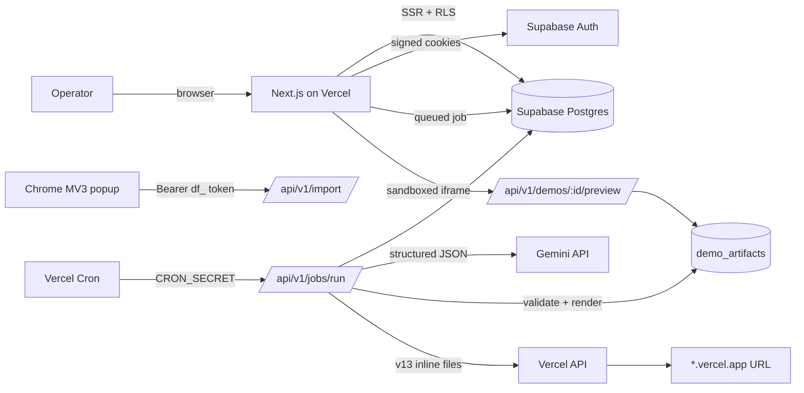

# Architecture

## Deployment identity

DemandForge is a personal, single-owner deployment. There is one verified owner account,
with independent Supabase sessions allowed on all three of the operator's PCs. Leads,
analyses, demos, deployments, and settings synchronize through Supabase; there is no team,
invitation, subscription, or public onboarding surface.

The first owner is created through `/setup` using the server-only `OWNER_SETUP_SECRET`.
The setup action creates a database-backed claim, and the claim is promoted to owner only
after Supabase email verification. A transaction-locked database function sets the persistent
initialization flag. After that flag is set, the app rejects setup and new auth-user creation;
the Supabase dashboard must also have **Allow new users to sign up** disabled.

## High level

## Module boundaries

| Module                       | Server-only | Responsibility                                       |
| ---------------------------- | ----------- | ---------------------------------------------------- |
| `src/lib/supabase/server.ts` | yes         | Cookie-bound client; RLS enforced                    |
| `src/lib/supabase/admin.ts`  | yes         | Service role; explicit user scoping required         |
| `src/lib/auth.ts`            | yes         | Session/profile helpers, page + API guards           |
| `src/lib/gemini/*`           | yes         | Prompting, schema validation, retries, usage         |
| `src/lib/demo/*`             | yes         | Rendering, artifact validation, preview document     |
| `src/lib/jobs/*`             | yes         | Queue, worker, handlers, idempotency                 |
| `src/lib/vercel/*`           | yes         | Deployment creation, polling, error mapping          |
| `src/lib/security/*`         | partly      | Hashing, canonical URLs, API tokens                  |
| `src/lib/validation/*`       | no          | Zod request schemas                                  |
| `src/features/*`             | mixed       | Queries (server) and interactive components (client) |
| `src/components/*`           | mixed       | Design system and shell                              |
| `extension/*`                | n/a         | Manifest, popup, service worker, build               |

`src/lib/env.ts` is the only module that reads server secrets. A static test enforces that no
Client Component imports a server-only module (`tests/unit/secret-exposure.test.ts`).

## Request flows

### Page request

1. `src/proxy.ts` refreshes the Supabase session, redirects unauthenticated visitors, and adds
   page security headers (CSP, `X-Frame-Options: DENY`).
2. The `(app)` layout calls `requireUser()` and loads the profile.
3. The page fetches through `createSupabaseServerClient()` (RLS) and renders Server Components.
4. Only interactive leaves hydrate on the client.

### Lead import

1. `POST /api/v1/leads` (cookie + origin check) or `POST /api/v1/import` (bearer token).
2. Zod validates text and URL; text is normalized; SHA-256 hash computed.
3. Lookup by canonical URL then hash, scoped to the authenticated user.
4. Insert with `user_id` from the session; unique violation is treated as a duplicate.
5. Audit event written; optional analysis job enqueued.

### Analysis

1. Route enqueues `analyze_lead` with idempotency `analyze:<leadId>:<updated_at>`.
2. Worker claims atomically, loads the lead scoped by user, marks `analyzing`.
3. Gemini returns JSON; Zod validates; budget is normalized; score computed.
4. Lead updated with analysis + evidence + score; usage recorded; audit written.
5. On failure: attempt recorded, retry scheduled with backoff, or job failed after max attempts.

### Demo generation

1. `POST /api/v1/demos` requires an analysed lead, creates the demo row, enqueues `generate_demo`.
2. Worker calls Gemini for the design spec, renders four files, validates the manifest.
3. Artifact upserted (`demo_id` unique), demo set to `ready`, previous approval cleared.
4. Invalid/unsafe output fails the job without storing an artifact.

### Approval and deployment

1. `POST /api/v1/demos/:id/approve` requires an artifact and `ready|approved`, sets
   `approved_at`, and moves the lead to `demo_generated`.
2. `POST /api/v1/demos/:id/deploy` requires approval and Vercel configuration, creates a
   `deployments` row, and enqueues `deploy_demo`.
3. Worker re-validates the artifact, creates a Vercel deployment (or polls an existing one on
   retry), waits for `READY` (bounded), and stores the URL.
4. Failures write the error to the deployment and demo; timeouts remain retryable.

### Preview

1. `GET /api/v1/demos/:id/preview` requires the session; RLS limits the artifact lookup.
2. Files are re-validated, inlined into one document, and served with a `sandbox` CSP.
3. The dashboard embeds it with `sandbox="allow-scripts"` (no `allow-same-origin`).

## Data ownership

All user tables carry `user_id` except `profiles` (`id`) and `demo_artifacts`/`job_attempts`
(derived through their parent). Policies use `(select auth.uid())`. Composite uniqueness is
scoped per user, so two accounts can import the same post independently.

## Failure design

- External HTTP calls use `AbortSignal` timeouts and typed errors (`GeminiError`, `VercelError`).
- Jobs record attempts in `job_attempts`, with sanitized errors (tokens redacted, 500 chars).
- Non-retryable causes (missing credentials, unsafe artifact, missing record) fail immediately
  with an actionable message instead of burning attempts.
- UI surfaces configuration status instead of falling back to mock data.

## Why not X

| Alternative                     | Decision                                                                                   |
| ------------------------------- | ------------------------------------------------------------------------------------------ |
| Separate Node worker            | Vercel functions + SQL queue cover the volume; fewer moving parts.                         |
| PGMQ                            | Adds an extension dependency; `SKIP LOCKED` is sufficient and portable.                    |
| Supabase Storage for artifacts  | Extra credentials and non-atomic approval; DB JSON manifest is simpler and capped in size. |
| Model-generated HTML directly   | Unsafe and non-deterministic; specification + renderer is verifiable.                      |
| Client-side Supabase for writes | Would widen the attack surface; mutations go through validated route handlers.             |
