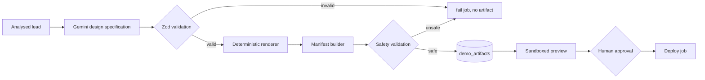

# Demo Generation

## Output contract

Exactly four files:

```
index.html
assets/css/styles.css
assets/js/main.js
README.md
```

No React, no bundler, no server code, no external assets. The page makes zero network requests
after load: system font stacks, no images beyond CSS shapes, no analytics.

## Pipeline



1. `POST /api/v1/demos` requires `analysis_status = 'analyzed'` and creates the demo row.
2. `generate_demo` worker calls Gemini for the specification.
3. `renderDemo()` writes the four files from the validated spec (no model-authored JS).
4. `validateDemoFiles()` enforces the safety rules below.
5. The artifact is upserted (`demo_id` unique), the demo becomes `ready`, approval is cleared.
6. The user previews in a sandboxed iframe, then approves.
7. `deploy_demo` re-validates and uploads to Vercel.

## Templates

| Template        | Layout                                  | Typical use                  |
| --------------- | --------------------------------------- | ---------------------------- |
| `local-service` | Split hero, services grid first         | Clinics, trades, restaurants |
| `portfolio`     | Centered hero, features first           | Personal brands, freelancers |
| `saas-landing`  | Product hero with panel, features first | SaaS/product concepts        |

All templates share tokenized CSS (colors from the model palette, system fonts, responsive
breakpoints at 900px), a mobile nav toggle, current-year stamp, and reduced-motion support.

## Validation rules (`src/lib/demo/validate.ts`)

| Check                                                                                    | Failure                          |
| ---------------------------------------------------------------------------------------- | -------------------------------- |
| Exact allowed path set, text values                                                      | Unexpected/missing file rejected |
| Per-file ≤300KB, total ≤700KB                                                            | Rejected                         |
| `index.html` starts with `<!doctype html>`, has charset, viewport, non-empty title       | Rejected                         |
| Exactly one script tag, `src="assets/js/main.js"`, no inline scripts                     | Rejected                         |
| No inline event handlers (`on*=`)                                                        | Rejected                         |
| No `iframe`, `object`, `embed`, `base`, `frame`, `form`, inline `<style>`                | Rejected                         |
| No `http(s)://` URLs anywhere                                                            | Rejected                         |
| No `javascript:`/`vbscript:`/`data:text/html`                                            | Rejected                         |
| Exactly one stylesheet link, `assets/css/styles.css`                                     | Rejected                         |
| CSS: balanced braces, no `@import`, no `url()`, no `expression()`                        | Rejected                         |
| JS: parses via `node:vm.Script`; no `eval`, `new Function`, `fetch`, XHR, WebSocket,     |
| storage, cookies, `postMessage`, parent/top access, dynamic import, navigation           | Rejected                         |
| No secret-like markers (`service_role`, `GEMINI_API_KEY`, `VERCEL_TOKEN`, `CRON_SECRET`, |
| `sb_secret_`)                                                                            | Rejected                         |
| README must say "concept"                                                                | Warning only                     |

Validation runs before storage **and** again before deployment. Invalid output fails the job
with a clear non-retryable message; nothing unsafe is stored.

## Preview isolation

- Route: `GET /api/v1/demos/:id/preview` (session required; RLS scopes the artifact).
- CSS and JS are inlined into one document; the file links are removed.
- Response CSP: `sandbox allow-scripts; default-src 'none'; style-src 'unsafe-inline';
script-src 'unsafe-inline'; img-src data:; base-uri 'none'; form-action 'none';
frame-ancestors 'self'`.
- The dashboard iframe uses `sandbox="allow-scripts"` **without** `allow-same-origin`, so the
  document has an opaque origin: it cannot read cookies, `localStorage`, or same-origin APIs.
- The dashboard page itself sets `X-Frame-Options: DENY`; the preview route is excluded.
- If preview were unavailable, the artifact remains downloadable as a self-contained HTML file.

## Approval

- `POST /api/v1/demos/:id/approve` requires a stored artifact and `ready|approved`.
- Sets `approved_at`, `generation_status = approved`, and moves the lead to `demo_generated`.
- Regeneration clears `approved_at`; the worker refuses deployment unless the artifact is
  currently approved.

## Fictional content

- The renderer injects fixed contact details: `hello@example.com`, `(555) 010-2030`, plus a
  "fictional details" note.
- Every page carries a "Concept demo generated by DemandForge AI · fictional business" banner.
- `README.md` states it is a concept and must not be presented as a live client site.
- The model is instructed not to use real personal data or copied passages.

## Regeneration and revisions

- Creating another demo for the same lead creates a new project (unique slug).
- Regenerating an existing demo replaces its artifact and requires re-approval.
- Deployment history is retained per demo.

## Tests

`tests/unit/demo.test.ts` covers the file contract, validation rejections (inline scripts,
handlers, frames, forms, external URLs, eval/fetch/cookie, syntax errors, unbalanced CSS,
`@import`, secrets, size), HTML escaping of model text, manifest checksums, and preview
inlining/sandboxing.
