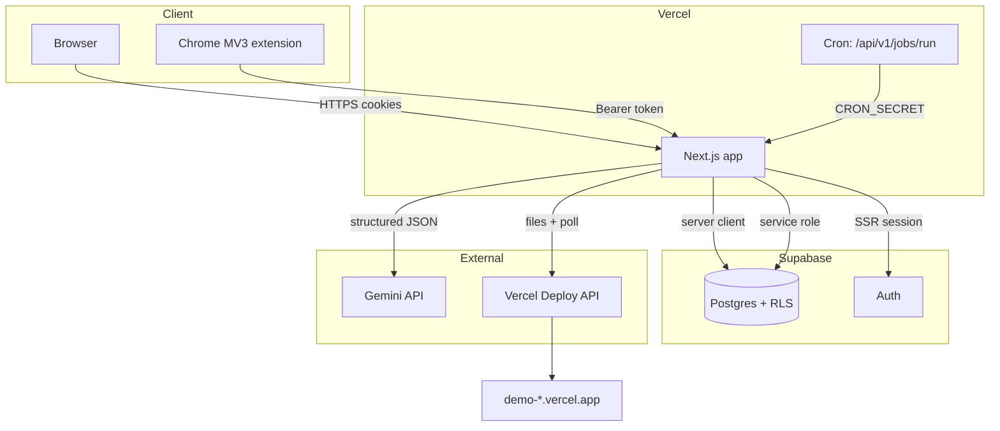
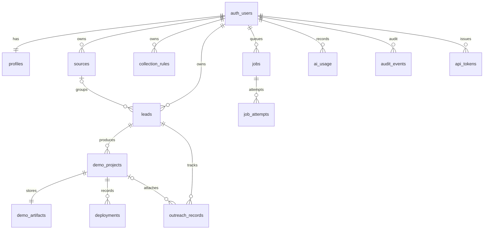
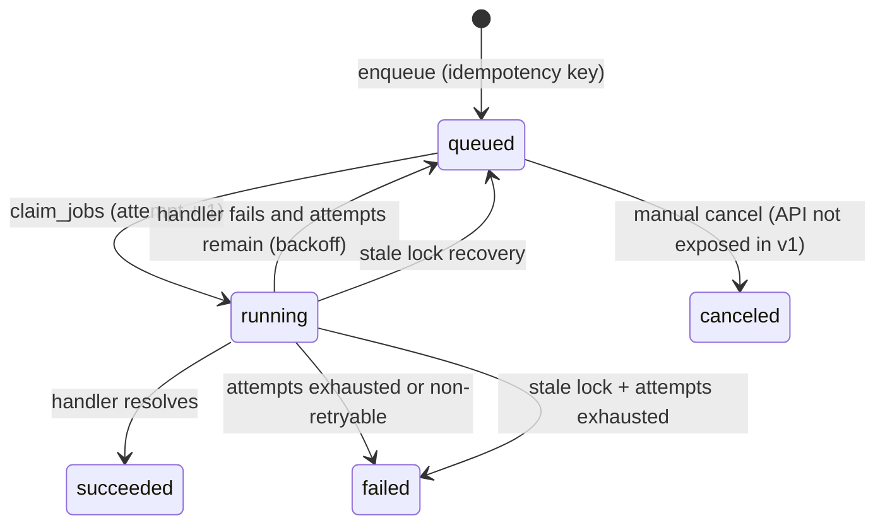
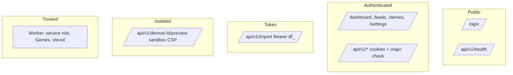

# System Diagrams

## Container view



## Data model



## Lead analysis sequence

```mermaid
sequenceDiagram
  actor U as Operator
  participant A as Next.js API
  participant DB as Postgres
  participant W as Worker
  participant G as Gemini

  U->>A: POST /api/v1/leads/:id/analyze
  A->>DB: enqueue analyze_lead (idempotency key)
  A-->>U: 202 { jobId }
  Note over A,W: after() may run immediately; cron guarantees durability
  W->>DB: claim_jobs(SKIP LOCKED)
  W->>DB: lead status = analyzing
  W->>G: generateContent (responseSchema)
  G-->>W: JSON + usage
  W->>W: Zod validate → normalize budget → score
  W->>DB: update lead + evidence + score; ai_usage; audit
  W->>DB: job succeeded
  U->>A: GET /leads/:id (poll)
  A->>DB: select lead (RLS)
  A-->>U: evidence + score breakdown
```

## Demo generation and deployment sequence

```mermaid
sequenceDiagram
  actor U as Operator
  participant A as Next.js API
  participant DB as Postgres
  participant W as Worker
  participant G as Gemini
  participant V as Vercel

  U->>A: POST /api/v1/demos {leadId, template}
  A->>DB: insert demo (queued) + enqueue generate_demo
  W->>DB: claim job
  W->>G: design specification
  G-->>W: validated spec JSON
  W->>W: render files + validate manifest
  W->>DB: upsert demo_artifacts; demo = ready
  U->>A: GET /api/v1/demos/:id/preview
  A-->>U: sandboxed document (opaque origin)
  U->>A: POST /api/v1/demos/:id/approve
  A->>DB: approved_at = now; lead = demo_generated
  U->>A: POST /api/v1/demos/:id/deploy
  A->>DB: insert deployment (queued) + enqueue deploy_demo
  W->>W: re-validate artifact
  W->>V: POST /v13/deployments (inline files)
  V-->>W: deployment id + url
  W->>V: poll until READY / timeout
  V-->>W: READY + immutable URL
  W->>DB: deployment ready; demo deployed + URL; audit
```

## Job state machine



## Security zones



- Public: login and health only.
- Authenticated: RLS plus ownership filters.
- Token: per-user extension token, hashed at rest.
- Isolated: opaque-origin preview, no cookies/API access.
- Trusted: service role and provider credentials exist only in server worker modules.
