# Vercel Deployment

## Strategy

Approved demo artifacts are deployed as **inline-file Vercel deployments** into one dedicated
project. Each deployment receives an immutable `https://<project>-<hash>.vercel.app` URL, which
is stored as the demo's live URL. No domain or alias customisation is needed.

Why this approach:

- Vercel does not deploy files stored in Supabase automatically; an explicit API call is required.
- Inline files avoid Git integration and per-demo repositories.
- A single dedicated project prevents writes to unrelated projects.
- Immutable deployment URLs remain stable even when newer demos are deployed to the same project.

## Configuration

| Variable              | Required    | Notes                                 |
| --------------------- | ----------- | ------------------------------------- |
| `VERCEL_TOKEN`        | yes         | Account/team token with deploy access |
| `VERCEL_TEAM_ID`      | no          | Required for team-owned projects      |
| `VERCEL_PROJECT_ID`   | recommended | Project id; strongest scoping         |
| `VERCEL_PROJECT_NAME` | fallback    | Default `demandforge-demos`           |

`isVercelConfigured()` requires a token and a project id or name. Missing configuration produces
`503 NOT_CONFIGURED` on the deploy route and a visible error card in the UI; nothing is mocked.

## API calls

### Create

```
POST https://api.vercel.com/v13/deployments?teamId=...
Authorization: Bearer <VERCEL_TOKEN>
Content-Type: application/json

{
  "name": "demandforge-demos",
  "project": "<VERCEL_PROJECT_ID>",
  "target": "production",
  "files": [{ "file": "index.html", "data": "<!doctype html>..." }, ...],
  "projectSettings": {
    "framework": null,
    "buildCommand": null,
    "installCommand": null,
    "outputDirectory": null
  },
  "meta": { "demandforge": "true", "demoId": "<uuid>" }
}
```

### Poll

```
GET https://api.vercel.com/v13/deployments/{id}?teamId=...
```

States: `QUEUED`, `INITIALIZING`, `BUILDING`, `READY`, `ERROR`, `CANCELED`. The worker polls
every 4s for up to 90s.

## Guarantees

- Deployment names come from configuration, never user input.
- A configured project name that differs from the environment's dedicated project and lacks a
  project id is refused (`forbidden`).
- Only `.vercel.app` hosts are accepted as URLs; anything else is an `invalid_response`.
- `deployed` state is written only after `READY` and a URL exist.
- Errors are recorded on both the deployment row and the demo, scrubbed of tokens.
- Retries poll an existing `vercel_deployment_id` instead of creating a second build.
- A deployment requires `approved_at` and `generation_status = 'approved'`.

## Lifecycle

```mermaid
stateDiagram-v2
  [*] --> queued: POST /demos/:id/deploy
  queued --> building: worker creates/polls Vercel deployment
  building --> ready: Vercel READY + URL
  building --> error: build failure
  building --> building: timeout (retryable; next attempt polls)
  error --> queued: user retries (new deployment row)
  ready --> [*]
```



## Operational steps

1. Create a Vercel project named `demandforge-demos` (an empty project is fine).
2. Create a token at `https://vercel.com/account/tokens` scoped to the team.
3. Set `VERCEL_TOKEN`, `VERCEL_TEAM_ID`, `VERCEL_PROJECT_ID`, and optionally
   `VERCEL_PROJECT_NAME` in the deployment environment.
4. Ensure `CRON_SECRET` is set so the worker can run; deployments are processed by the queue.
5. Approve a demo, then click **Deploy to Vercel**. The UI polls until the status changes and
   links the real URL.
6. Verify in **Deployments** that status is `ready` and the URL opens.

## Failure handling

| Condition                        | Behaviour                                             |
| -------------------------------- | ----------------------------------------------------- |
| Missing token/project            | 503 configuration error; deployment row not created   |
| Invalid token (401)              | Deployment error: "Vercel rejected the access token." |
| Token lacks project access (403) | Error recorded; no retry                              |
| Rate limit (429) / 5xx           | Retryable; backoff via the job queue                  |
| Build fails                      | `build_failed` with Vercel's message; status `error`  |
| Poll timeout                     | Retryable; next attempt polls the same deployment     |
| Worker killed                    | Stale job recovery requeues; poll continues           |

## Limitations

- No custom domains, aliases, or per-demo projects in v1.
- Live deployment is not verified in this environment (no token). Unit tests cover request
  shape, error mapping, URL validation, and readiness polling; see `docs/TEST-REPORT.md`.
- Deployments target `production` of the dedicated demo project, so the project's primary alias
  points at the most recent deployment; the stored per-deployment URL is immutable.
